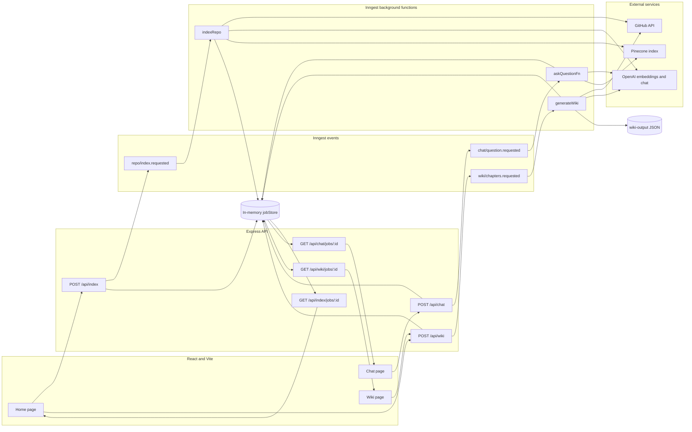

# Git Wiki Build

Git Wiki Build indexes the text files in a GitHub repository into Pinecone, then answers repository questions with retrieval-augmented generation (RAG). It can also inspect the repository directly and generate a wiki-style set of chapters, each with explanatory Markdown and a Mermaid diagram.

The backend is an Express application whose longer-running work is handled by Inngest functions. It uses the GitHub API to fetch files, OpenAI for embeddings and generated text, and Pinecone for vector storage and retrieval. The separate React/Vite application under `web/` calls the backend through Vite's `/api` development proxy.

## Architecture



- **Express** exposes the HTTP API on port 5555 and serves the Inngest function endpoint.
- **Inngest** runs repository indexing, RAG questions, and wiki generation as background jobs. Its local dashboard runs on port 8288.
- **GitHub API** supplies repository metadata and file contents.
- **OpenAI** supplies `text-embedding-3-small` embeddings and `gpt-4o-mini` text generation.
- **Pinecone** stores repository chunks in a namespace derived from `owner/repo`.
- **React + Vite** provides the browser UI on port 5173 and proxies `/api` calls to Express.

## Prerequisites

- Node.js and npm
- An OpenAI API key
- A Pinecone API key and serverless index
- A GitHub token if you need private-repository access or higher GitHub API limits; public repositories can be read without one

## Setup

1. Install the backend dependencies from the repository root:

   ```powershell
   npm install
   ```

2. Install the frontend dependencies:

   ```powershell
   cd web
   npm install
   cd ..
   ```

3. Copy `.env.example` to `.env` in the repository root and fill in the real secrets. Keep secrets only in `.env`; it is ignored by Git.

   ```dotenv
   INNGEST_DEV=1
   PORT=5555
   OPENAI_API_KEY=
   PINECONE_API_KEY=
   PINECONE_INDEX=git-wiki
   GITHUB_TOKEN=
   ```

   `OPENAI_API_KEY` and `PINECONE_API_KEY` are required. `GITHUB_TOKEN` may remain blank for small public-repository tests.

4. If you are starting with a new Pinecone account, create the index before running an indexing job:

   - Name: `git-wiki` (or the value of `PINECONE_INDEX`)
   - Type: serverless
   - Cloud: AWS
   - Region: `us-east-1`
   - Dimensions: `1536`
   - Similarity metric: cosine

   The 1536 dimensions must match OpenAI's `text-embedding-3-small` model used by the backend.

## Local development

Run these three processes at the same time in separate terminals.

1. Start the Express application from the repository root:

   ```powershell
   npm run dev
   ```

   The API listens at `http://localhost:5555`.

2. Start the Inngest development server from the repository root:

   ```powershell
   npx inngest-cli@latest dev -u http://localhost:5555/api/inngest
   ```

   Its dashboard is available at `http://localhost:8288`.

3. Start Vite from the frontend directory:

   ```powershell
   cd web
   npm run dev
   ```

   The browser application is available at `http://localhost:5173`. During development, Vite forwards relative `/api` requests to the Express server on port 5555.

Run the backend tests with `npm test`. Check a production frontend build with `cd web` followed by `npm run build`.

## Testing

Run the backend unit and route-contract tests from the repository root:

```powershell
npm test
```

The Playwright suite expects the Express app, Inngest dev server, and Vite dev server described above to already be running. Install its isolated dependencies and Chromium once, then run both browser specs:

```powershell
cd e2e
npm install
npx playwright install chromium
npm test
```

The Chat spec ensures Spoon-Knife is indexed, submits a browser question, and waits for an answer in the DOM. The Wiki spec starts a fresh generation job through Home, follows its UI link, switches chapters, and verifies that exactly one Mermaid SVG is present after each switch.

## API

All request bodies are JSON.

- `POST /api/index` — accepts `{ "repo": "owner/repo" }` and returns `202` with an indexing job ID.
- `GET /api/index/jobs/:id` — returns the pending, completed, or failed state of an indexing job; completed results include file/chunk counts, `saved`, and `truncated`.
- `POST /api/chat` — accepts `{ "repo": "owner/repo", "question": "..." }` and returns `202` with a chat job ID.
- `GET /api/chat/jobs/:id` — returns the pending, completed, or failed state of a chat job; completed results include `answer` and `sources`.
- `POST /api/wiki` — accepts `{ "repo": "owner/repo" }` and returns `202` with a wiki-generation job ID.
- `GET /api/wiki/jobs/:id` — returns the pending, completed, or failed state of a wiki job; completed results include the repository, generation time, and chapters.

## Known limitations

- The generic job store is an in-memory `Map`. Index, chat, and wiki job IDs and results disappear whenever the Express process restarts.
- Completed wiki output is also written to `wiki-output/<owner>-<repo>.json`, so the latest generated wiki survives a process restart even though its polling job does not. Generating the same repository again replaces that repository's JSON file.
- GitHub fetching indexes at most 200 eligible files. The indexing function reports `truncated: true` internally when the recursive Git tree or the 200-file cap means the repository was only partially processed.
- Files larger than 200 KB, common generated/dependency directories, binary formats, lockfiles, and minified JavaScript are intentionally skipped.
- The frontend is configured for local development through Vite's proxy. A production deployment still needs an appropriate frontend host and API routing configuration.
