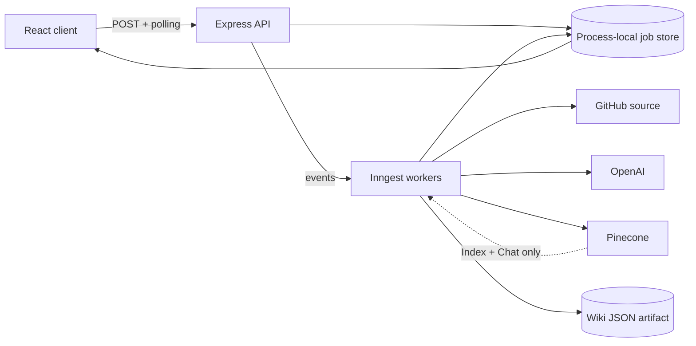

# AutoWiki for Git

AutoWiki turns a public GitHub repository into a navigable technical wiki. Its primary pipeline reads repository source, plans a bounded chapter outline, then generates each chapter’s Markdown explanation and Mermaid diagram together. Repository indexing and source-grounded Q&A are separate supporting workflows.

The application is designed as a local, single-process college project and demo system. It does not claim authentication, multi-user persistence, automatic synchronization, or production-scale reliability.

## What it includes

- Cinematic mint/aqua Landing with bounded vertical and horizontal source-to-document storytelling.
- Workspace for starting independent Wiki-generation and repository-indexing jobs.
- Live Wiki reader with chapter navigation, secure Markdown, source paths, Mermaid rendering, and an expanded diagram viewer.
- Repository-grounded Chat that keeps every answer bound to its submitted repository, question, and returned source paths.
- Interactive Architecture Explorer grounded in the current source files.
- Backend-independent pre-generated Spoon-Knife sample at `/wiki/sample/spoon-knife`.
- Reduced-motion, keyboard, mobile, loading, failure, and polling-recovery paths.

## Stack

- React 19, React Router 7, Vite 8, Tailwind CSS 4
- GSAP, `@gsap/react`, and ScrollTrigger
- React Markdown, Remark GFM, and Mermaid
- Express 5 and Inngest
- OpenAI through LangChain, Pinecone, and the GitHub API through Octokit
- Node’s test runner and Playwright

## Architecture



Wiki generation consumes repository source directly and does not depend on Pinecone. Pinecone is used only by the separate Index and Chat workflow.

## Routes

| Route | Purpose |
|---|---|
| `/` | Product story and authentic sample previews |
| `/workspace` | Start Wiki and Index jobs |
| `/wiki` | Wiki entry state |
| `/wiki?jobId=...` | Pending, failed, or completed live Wiki job |
| `/wiki/sample/spoon-knife` | Offline-backend pre-generated sample |
| `/chat` | Grounded repository Q&A |
| `/architecture` | Interactive source-backed system explorer |

## Prerequisites

- Node.js and npm
- `OPENAI_API_KEY`
- `PINECONE_API_KEY` and a Pinecone index
- Optional `GITHUB_TOKEN` for a higher public GitHub rate limit

The Pinecone index must use 1536 dimensions and cosine similarity to match `text-embedding-3-small`.

## Setup

Install each package tree:

```powershell
npm install
npm --prefix web install
npm --prefix e2e install
```

Copy `.env.example` to `.env` at the repository root and fill in values locally:

```dotenv
INNGEST_DEV=1
PORT=5555
OPENAI_API_KEY=
PINECONE_API_KEY=
PINECONE_INDEX=
GITHUB_TOKEN=
```

`.env` is ignored by Git. Never place provider keys in React code, Inngest event data, screenshots, or logs.

## Start the application

Use three terminals in this order.

1. Express:

   ```powershell
   npm run dev
   ```

   Verify Express only at `http://localhost:5555/api/health`. A successful response is `{"status":"ok","service":"autowiki-api"}`.

2. Inngest:

   ```powershell
   npm run dev:inngest
   ```

   The pinned development CLI starts at `http://localhost:8288` and registers `http://localhost:5555/api/inngest`. Wait for `apps synced` before starting a live job.

3. Vite:

   ```powershell
   npm run dev:web
   ```

   Open `http://localhost:5173`.

`INNGEST_DEV=1` makes the installed SDK send development events to `http://localhost:8288`. Express can be healthy while the runner is absent; in that case a job submission fails before GitHub, OpenAI, or Pinecone work begins. Starting the runner is a readiness requirement, not an optional dashboard step.

## Main workflows

### Generate a Wiki

Open Workspace, enter `owner/repository`, and choose **Generate Wiki**. Express returns a job ID immediately. The worker fetches eligible source, plans the outline, writes chapters and diagrams, saves a JSON artifact, and marks the job complete. The UI polls the job endpoint and can retry a failed status check without submitting a duplicate generation job.

### Index and ask

Index the repository from Workspace first. After the Index job completes, open Chat, ask a question, and inspect the returned source paths beside the Markdown answer. Indexing does not create a Wiki; generating a Wiki does not create a Pinecone index.

### Use the sample

Open `/wiki/sample/spoon-knife` when backend or provider services are unavailable. The route imports the committed fixture directly, makes no API/provider requests, and uses the same reader as live jobs. It is labeled pre-generated and must not be presented as a fresh live generation.

## API

All request bodies are JSON.

- `GET /api/health` — Express-process health only.
- `POST /api/wiki` with `{ "repo": "owner/repo" }`.
- `GET /api/wiki/jobs/:jobId`.
- `POST /api/index` with `{ "repo": "owner/repo" }`.
- `GET /api/index/jobs/:jobId`.
- `POST /api/chat` with `{ "repo": "owner/repo", "question": "..." }`.
- `GET /api/chat/jobs/:jobId`.
- `/api/inngest` — Inngest registration and invocation endpoint.

Jobs expose `pending`, `completed`, or `failed`. A transient polling transport error is not treated as proof that the background job failed.

## Testing

Backend unit and route-contract tests:

```powershell
npm test
```

Frontend checks:

```powershell
npm --prefix web run lint
npm --prefix web run build
```

Playwright expects the three local services to be ready:

```powershell
npm --prefix e2e test -- --reporter=line
```

The browser inventory contains deterministic mocked UI tests, responsive and reduced-motion checks, horizontal/vertical scroll tests, sample-mode tests, Mermaid exactly-one-SVG regression coverage, and live Wiki/Index/Chat specs. Report mocked, sample, and live results separately.

## Demo documentation

- [DEMO.md](DEMO.md) — primary and fallback viva walkthroughs plus troubleshooting.
- [VIVA_NOTES.md](VIVA_NOTES.md) — concise technical defense grounded in the implementation.
- [DESIGN.md](DESIGN.md) — final visual and motion system.
- [PRODUCT.md](PRODUCT.md) — product truth and constraints.

## Known limitations

- The shared job store is an in-memory `Map`; server restarts lose polling records and multiple Express instances cannot share them.
- Generated Wiki JSON survives locally, but no endpoint rehydrates a lost job from the artifact.
- Repository fetching reads at most 200 eligible text files and skips generated/dependency directories, binary formats, lockfiles, minified JavaScript, and files over 200 KB.
- Public GitHub requests without a token use the lower unauthenticated quota.
- Provider credentials, quotas, billing, network access, and Pinecone availability can block live flows.
- Re-indexing upserts stable chunk IDs but does not delete older vectors that no longer appear in the repository.
- Chat has no conversation memory; every question is an independent job.
- Production hosting still needs durable shared state, durable artifact storage, and deployment-specific frontend/API routing.
